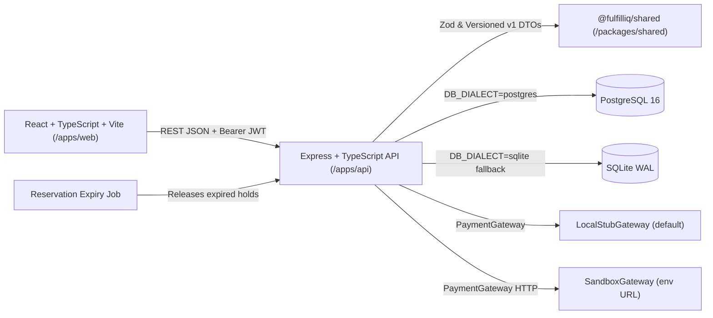
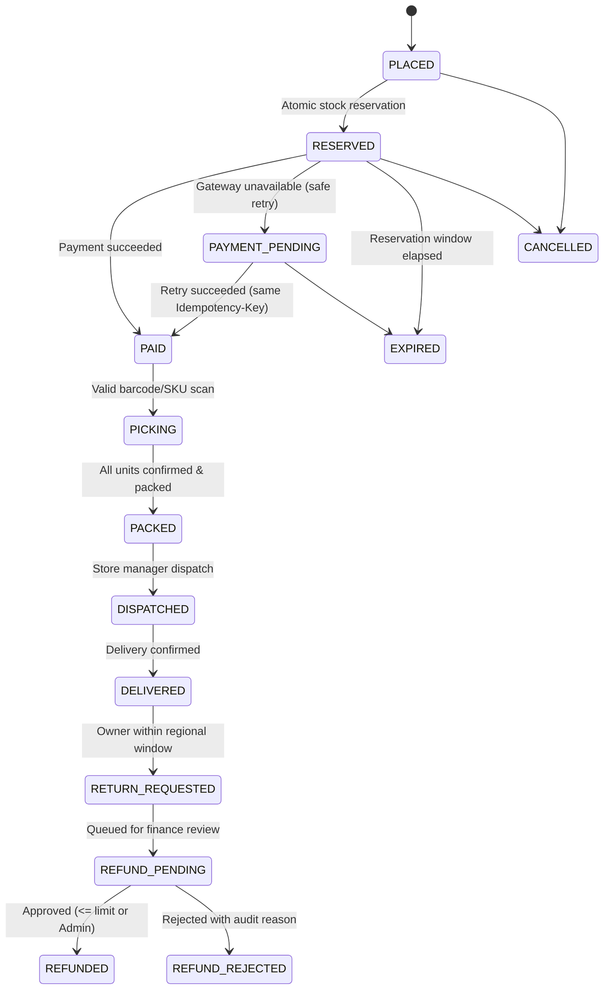

# FulfillIQ — Omnichannel Order Fulfilment Platform

FulfillIQ is a full-stack omnichannel order fulfilment platform built for CSA10 Software Engineering. It makes every synthetic order traceable from checkout and atomic stock reservation through payment idempotency, barcode picking, dispatch, customer tracking, and governed, auditable regional refunds.

> **Simulation & Synthetic Data Notice:** All products, warehouses, customer names, addresses, and payment tokens (`TEST MODE`) are 100% synthetic. No real customer PII or real card data is stored or processed. The optional **Delivery Board** page displays **SIMULATED PLANNING DATA, not actual team delivery**, kept strictly separate from the operational order lifecycle. Deterministic fixed-threshold low-stock alerts are used throughout; no machine-learning forecasting is implemented.

---

## Architecture



### Order State Machine



---

## Quick Start (< 5 Minutes)

### Option A: Local Development (Zero-Config SQLite Fallback)
```bash
cp .env.example .env
npm install
npm run dev
```
Open `http://localhost:3000`. Migrations and synthetic seed data run automatically on startup.
Interactive OpenAPI docs are available at `http://localhost:3000/api/docs` (JSON at `/api/docs.json`).

### Option B: Docker Compose (PostgreSQL 16 + API + Nginx Web)
```bash
docker compose up --build -d
```
- Web UI: `http://localhost:8080`
- API + OpenAPI Docs: `http://localhost:4000/api/docs`
- Health / Readiness: `http://localhost:4000/health` and `http://localhost:4000/ready`
- Persistent PostgreSQL volume `fulfilliq_pgdata` preserves all orders, stock, regions, and audit logs across container restarts.

---

## Demo Credentials (**DEMO ONLY** — Do Not Use In Production)

Password for all seeded synthetic accounts: **`DemoPass123!`**

| Role | Email | Capabilities |
| :--- | :--- | :--- |
| `customer` | `customer@demo.fulfilliq.test` | Browse, cart, checkout, track own orders, request returns |
| `customer` (2) | `customer2@demo.fulfilliq.test` | Second customer for ownership isolation checks |
| `picker` | `picker@demo.fulfilliq.test` | Paid+reserved pick lists, barcode/SKU confirmation, pack |
| `support_agent` | `support@demo.fulfilliq.test` | Order/email/phone lookup, queue verified returns (cannot approve refunds or correct stock) |
| `store_manager` | `manager@demo.fulfilliq.test` | Dispatch/deliver orders, resolve low-stock alerts, audited stock corrections |
| `finance_reviewer` | `finance@demo.fulfilliq.test` | Approve/reject refunds within regional limit, reconciliation, audit log |
| `admin` | `admin@demo.fulfilliq.test` | Users/roles, regional policies, thresholds, gateway config, over-limit refunds |

---

## Running Automated Tests & Demo Journey

```bash
# Run full Vitest + Supertest suite (concurrency, idempotency, outage, RBAC, state machine, limits, restart, alerts)
npm test

# Run end-to-end synthetic order-to-delivered & return-to-refunded journey with audit printout
npm run demo:journey

# Typecheck & build production frontend
npm run lint
npm run build
```

---

## API Overview (v1.0.0)

- **Health & Docs:** `GET /health`, `GET /ready`, `GET /api/docs`, `GET /api/docs.json`
- **Auth:** `POST /api/auth/login` (rate-limited), `GET /api/auth/me`
- **Catalog & Regions:** `GET /api/regions`, `GET /api/warehouses`, `GET /api/products`, `GET /api/products/:id`
- **Orders & Tracking:** `POST /api/orders`, `GET /api/orders`, `GET /api/orders/:id`, `PATCH /api/orders/:id/status`, `GET /api/orders/:id/tracking`
- **Payments & Reconciliation:** `POST /api/payments` (requires `Idempotency-Key`), `POST /api/payments/:orderId/retry`, `GET /api/finance/reconciliation`
- **Picking:** `GET /api/picking/queue`, `POST /api/picking/:orderId/scan`, `POST /api/picking/:orderId/pack`
- **Returns & Refunds:** `POST /api/orders/:id/return`, `GET /api/returns`, `POST /api/returns/:id/queue-refund`, `POST /api/returns/:id/decision`
- **Support, Alerts & Audit:** `GET /api/support/orders`, `GET /api/alerts/low-stock`, `POST /api/alerts/low-stock/:id/resolve`, `POST /api/inventory/corrections`, `GET /api/audit`
- **Admin:** `GET /api/admin/users`, `PATCH /api/admin/users/:id/role`, `POST /api/admin/regions`, `PATCH /api/admin/regions/:regionId`, `PATCH /api/admin/products/:id/threshold`, `GET/PATCH /api/admin/gateway`
- **Delivery Board (Simulated):** `GET /api/delivery-board`, `PATCH /api/delivery-board/:id`

---

## Story Mapping (S01–S13)

| Story | Scope | Implemented Files | Automated Test Coverage |
| :--- | :--- | :--- | :--- |
| **S01** | Login & RBAC | `apps/api/src/routes/auth.ts`, `apps/api/src/middleware/auth.ts`, `apps/web/src/pages/LoginPage.tsx` | `s01_auth_rbac.test.ts` |
| **S02** | Atomic Stock Reservation & Expiry | `apps/api/src/routes/orders.ts`, `apps/api/src/services/inventoryService.ts`, `apps/api/src/jobs/reservationExpiryJob.ts` | `s02_concurrency_expiry.test.ts` |
| **S03a** | Payment Idempotency Key & Stub | `apps/api/src/routes/payments.ts`, `apps/api/src/services/paymentGateway.ts` | `s03_payments_idempotency_outage.test.ts` |
| **S03b** | Sandbox Gateway & Safe Retry | `apps/api/src/services/paymentGateway.ts`, `apps/api/src/routes/admin.ts`, `apps/web/src/pages/AdminPage.tsx` | `s03_payments_idempotency_outage.test.ts` |
| **S04** | Paid+Reserved Pick List | `apps/api/src/routes/picking.ts`, `apps/web/src/pages/PickerPage.tsx` | `s01_auth_rbac.test.ts`, `s04_s12_picking_barcode.test.ts` |
| **S05** | Strict Order State Machine | `packages/shared/src/stateMachine.ts`, `apps/api/src/services/orderStateMachine.ts`, `apps/web/src/pages/DispatchPage.tsx` | `s05_s06_state_machine_tracking.test.ts` |
| **S06** | Accessible Tracking Milestones | `packages/shared/src/stateMachine.ts`, `apps/api/src/routes/orders.ts`, `apps/web/src/pages/MyOrdersPage.tsx` | `s05_s06_state_machine_tracking.test.ts` |
| **S07** | Return Request & Regional Window | `apps/api/src/routes/returns.ts`, `apps/web/src/pages/MyOrdersPage.tsx` | `s07_s08_returns_refund_limit.test.ts` |
| **S08** | Refund Approval & Regional Limit | `apps/api/src/routes/returns.ts`, `apps/api/src/services/auditService.ts`, `apps/web/src/pages/FinancePage.tsx` | `s07_s08_returns_refund_limit.test.ts` |
| **S09** | Build, Health/Ready & Restart Persistence | `apps/api/src/routes/health.ts`, `docker-compose.yml`, `apps/api/Dockerfile`, `apps/web/Dockerfile` | `s09_s10_s11_health_support_alerts_restart.test.ts` |
| **S10** | Support Lookup Console | `apps/api/src/routes/orders.ts`, `apps/web/src/pages/SupportPage.tsx` | `s09_s10_s11_health_support_alerts_restart.test.ts` |
| **S11** | Deterministic Low-Stock Alert Rule | `apps/api/src/services/inventoryService.ts`, `apps/api/src/routes/alerts.ts`, `apps/web/src/pages/DispatchPage.tsx` | `s09_s10_s11_health_support_alerts_restart.test.ts` |
| **S12** | Barcode Pick Confirmation & Fallback | `apps/api/src/routes/picking.ts`, `apps/web/src/pages/PickerPage.tsx` | `s04_s12_picking_barcode.test.ts` |
| **S13** | Sales Analytics & ML (DEFERRED) | Roadmap note only in `apps/web/src/pages/DeliveryBoardPage.tsx` | Deferred out of first release |

---

## Known Limitations

1. **Synthetic Payment & Sandbox Adapter:** No live PCI payment processor is connected; `LocalStubGateway` is active by default and `SandboxGateway` targets a configurable test HTTP endpoint.
2. **PostgreSQL vs SQLite in Local Preview:** Local dev defaults to `DB_DIALECT=sqlite` (with WAL mode and serialized transactions) for zero-dependency startup, while `docker-compose.yml` runs PostgreSQL 16 (`DB_DIALECT=postgres`).
3. **Single-Process Expiry Interval:** Reservation expiry runs as an in-process timer (`30s` interval) rather than an external distributed cron worker.
4. **Deferred Scope (S13):** Sales analytics dashboards, ML demand forecasting, recommendations, loyalty, and multi-currency pricing are intentionally omitted from the first release.
